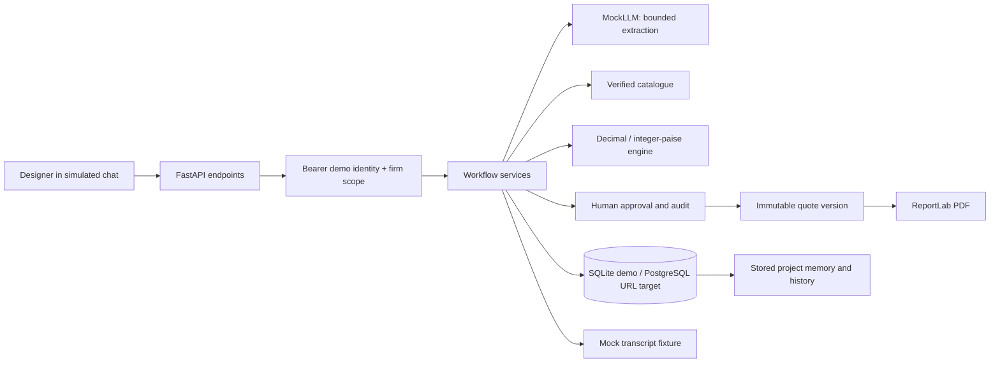

# Qshift architecture (Phase 0–2 prototype)

The model adapter proposes typed operations. Services validate every target and rate, apply only verified catalogue records, recompute with deterministic code, and produce a draft bound to its base version and content digest. The approval service checks the authenticated role, exact content hash, expiry, current quote base and current rate-card reference before appending an approved version. PDF rendering uses the persisted approved version. Project memory reads stored operations and versions only.

Every persistent business row has `firm_id` and every service query includes it. The browser demo bearer tokens represent fictional users and are not production authentication. SQLite is exercised locally. PostgreSQL deployment and concurrency behavior have not been validated in this run.

